# 🛡️ Awesome Intelligent Autonomous Defense Logistics

<p align="center">
  
</p>

<p align="center">
  <a href="https://github.com/ishandutta2007/Awesome-Awesome-Awesome"></a>
  <a href="https://discord.gg/jc4xtF58Ve"></a>
  <a href="https://github.com/ishandutta2007/Awesome-Intelligent-Autonomous-Defense-Logistics/stargazers"></a>
  <a href="https://github.com/ishandutta2007/Awesome-Intelligent-Autonomous-Defense-Logistics/network/members"></a>
  <a href="https://github.com/ishandutta2007/Awesome-Intelligent-Autonomous-Defense-Logistics/issues"></a>
  <a href="https://github.com/ishandutta2007/Awesome-Intelligent-Autonomous-Defense-Logistics/blob/main/LICENSE"></a>
  <a href="https://github.com/ishandutta2007"></a>
</p>

---

## 🎯 Executive Summary & Mission Overview

A curated directory of **Enterprise SaaS Platforms** and **Production-Grade Open-Source Frameworks** powering **Intelligent Autonomous Defense Logistics**. Designed for defense engineers, military program offices (PEO/PM), defense prime contractors, aerospace roboticists, and tactical software developers.

Modern operational theaters require robust capabilities across:
- 🚛 **Contested Logistics & Degraded Comms (PACE Plan Resupply)**: Navigating dynamic, adversarial environments without reliance on constant SATCOM, GPS, or fixed lines of communication.
- 🤖 **Autonomous Multi-Domain Unmanned Resupply**: Coordinated aerial (UAS/eVTOL), maritime (USV/UUV), and ground (UGV) autonomous delivery swarms.
- ⚙️ **Predictive Maintenance & Fleet Readiness (CBM+)**: AI/ML-driven failure anticipation, telemetry analytics, and edge-deployed diagnostic models.
- 🔒 **Cryptographic Supply Chain Integrity**: Zero-trust provenance, software bill of materials (SBOM), tamper-proof signing, and air-gapped container artifact replication.

---

## 📑 Table of Contents

- [📊 Sector Overview & Market Dynamics](#-sector-overview--market-dynamics)
- [🏢 SaaS & Hosted Defense Platforms](#-saas--hosted-defense-platforms)
- [💻 Open-Source GitHub Projects](#-open-source-github-projects)
  - [Top Tier Core Infrastructure](#top-tier-core-infrastructure)
  - [Specialized Autonomous & Geospatial Components](#specialized-autonomous--geospatial-components)
- [🏗️ Architectural Reference Blueprints](#️-architectural-reference-blueprints)
- [🤝 How to Contribute](#-how-to-contribute)
- [☕ Support](#-support)
- [⭐ Star History](#-star-history)
- [⚠️ Compliance & Security Disclaimer](#️-compliance--security-disclaimer)

---

## 📊 Sector Overview & Market Dynamics

The global military logistics market is valued at **$445 billion in 2026** and projected to surpass **$580 billion by 2030** (growing at a 5.8% to 7.0% CAGR), with the high-autonomy defense logistics and AI-predictive maintenance software sub-segments surging at an accelerated **~14% CAGR**.

The market displays a **moderately fragmented** dynamic:
- **Concentrated Tier-1 Core**: The command-and-control software layer and major system integration programs remain concentrated among a small cadre of well-capitalized defense primes and hyper-scale defense-tech leaders (e.g., Palantir, Anduril, Applied Intuition) who capture high-margin, winner-take-most enterprise operating system contracts.
- **Fragmented Edge & Subsystem Ecosystem**: The underlying autonomy stack, edge robotics, specialized routing engines, field data ingestion tools, and regional logistics operators remain highly fragmented with hundreds of innovative dual-use startups and modular open-source protocols actively competing for programmatic insertion points.

---

## 🏢 SaaS & Hosted Defense Platforms

The following enterprise platforms provide managed, accredited, and specialized command, control, simulation, and intelligence capabilities for defense logistics.

*Table sorted descending by company scale (Valuation / Market Capitalization):*

| Product / Platform | Company Scale (Valuation / Revenue) | Pricing | Free Tier / Trial Limits | Core Defense Logistics Focus |
| :--- | :--- | :--- | :--- | :--- |
| **[Palantir Gotham](https://www.palantir.com/platforms/gotham/)** | **~$460B Market Cap** (~$2.8B+ ARR) | Starting at **$100,000/mo** ($1.2M/yr modular base commitment) | **No free trial or free tier**; custom 30–90 day paid Proof-of-Concept (PoC) pilot scoped via IL5/IL6 government agreements | Multi-domain defense operating system, supply pipeline bottleneck prediction, entity resolution, and classified C2 logistics data integration. |
| **[Anduril Lattice](https://www.anduril.com/lattice/)** | **$61B Valuation** (~$2.2B Revenue) | Starting at **$250,000/yr** (hardware-software integration tier) | **No free trial or free tier**; evaluation via defense hardware-in-the-loop pilot programs | Autonomous asset tasking, mesh networking, sensor/effector fusion, and contested-environment autonomous resupply orchestration. |
| **[Applied Intuition Defense](https://www.appliedintuition.com/)** | **$30B Valuation** (~$830M ARR) | Starting at **$50,000/yr** per engineering seat / simulation suite | **No self-serve free tier**; 30-day enterprise evaluation license provided under NDA and security review | High-fidelity synthetic environment simulation, autonomous ground/air vehicle validation, and edge sensor software test harnesses. |
| **[Helsing](https://helsing.ai/)** | **$18B Valuation** (~$502M Revenue) | Starting at **€200,000/yr** (pilot deployment base) | **No free trial or free tier**; sovereign defense access and structured procurement trials only | Real-time sensor fusion, electronic warfare processing, and autonomous tactical vehicle logistics coordination for NATO/European forces. |
| **[Shield AI Hivemind](https://shield.ai/hivemind/)** | **$12.7B Valuation** (~$300M–$540M Revenue) | Starting at **$300,000/yr** (autonomy stack license) | **No free trial or free tier**; military capability demonstrations and scoped flight trial evaluations | GPS-denied and comms-denied swarm autonomy, enabling unmanned aircraft teams to execute contested battlefield resupply missions. |
| **[Saronic](https://www.saronic.com/)** | **$9.25B Valuation** (~$200M+ Revenue) | Starting at **$350,000 per vessel/year** (autonomous software-as-a-fleet) | **No free trial or free tier**; live sea demonstration and operational testing trials for defense agencies | Autonomous surface vessels (ASVs) purpose-built for maritime contested logistics, attritable resupply, and fleet surveillance. |
| **[C3 AI Defense](https://c3.ai/industries/defense/)** | **~$1.85B Market Cap** (~$310M Revenue) | Starting at **$250,000** (flat fee for 3-month production pilot, then ~$0.55/vCPU-hr) | **14-day free trial** on select cloud marketplace standard editions (capped at 5 users and 500GB ingested data); no permanent free tier | Predictive maintenance (CBM+), supply chain disruption forecasting, and weapon system mission readiness optimization. |
| **[Vannevar Labs](https://www.vannevarlabs.com/)** | **~$1.1B Valuation** (~$85M ARR) | Starting at **$120,000/yr** (Decryp/Mission base seat tier) | **No free trial or free tier**; clearance-verified federal pilot access only | Operational intelligence, foreign language document exploitation, and maritime supply corridor monitoring in contested theaters. |
| **[Primer AI](https://primer.ai/)** | **~$380M Valuation** (~$48M Revenue) | Starting at **$60,000/yr** (Primer Platform intelligence base) | **No free trial or free tier**; 14-day guided sandbox demo for qualified government and defense defense contractor accounts | NLP document synthesis, multi-source unstructured intelligence analysis, and situational threat tracking across supply corridors. |
| **[Rebellion Defense](https://rebelliondefense.com/)** | **~$350M Valuation** (~$25M Revenue) | Starting at **$100,000/yr** (Rebellion Iris / Dispatch tier) | **No free trial or free tier**; mission-specific prototype and government cooperative pilots only | AI-driven threat assessment, mission planning software, and logistics route vulnerability scoring under degraded comms. |

---

## 💻 Open-Source GitHub Projects

Open-source infrastructure forms the vendor-independent foundation for sovereign, air-gapped, and transparent defense logistics systems.

*All repositories are sorted descending by GitHub Stars_Count:*

### Top Tier Core Infrastructure

| Repository | GitHub_Stars | License | Primary Architectural Role in Defense Logistics |
| :--- | :---: | :--- | :--- |
| **[TensorFlow](https://github.com/tensorflow/tensorflow)** | [](https://github.com/tensorflow/tensorflow/stargazers) | Apache-2.0 | Machine learning platform powering predictive component maintenance and edge inference via **TensorFlow Lite** on unmanned resupply platforms. |
| **[Kubernetes](https://github.com/kubernetes/kubernetes)** | [](https://github.com/kubernetes/kubernetes/stargazers) | Apache-2.0 | Resilient container orchestration for contested environments; runs air-gapped and tactical edge computing clusters with self-healing nodes. |
| **[PyTorch](https://github.com/pytorch/pytorch)** | [](https://github.com/pytorch/pytorch/stargazers) | BSD-3-Clause | Dominant deep learning framework for autonomous system vision, multi-agent reinforcement learning, and acoustic sensor fusion. |
| **[Apache Airflow](https://github.com/apache/airflow)** | [](https://github.com/apache/airflow/stargazers) | Apache-2.0 | Programmatic DAG workflow orchestration for defense logistics ETL, inventory reconciliation, and scheduled replenishment pipelines. |
| **[Ray](https://github.com/ray-project/ray)** | [](https://github.com/ray-project/ray/stargazers) | Apache-2.0 | Distributed compute fabric for training multi-agent swarm algorithms and serving large-scale logistics optimization models in parallel. |
| **[Keycloak](https://github.com/keycloak/keycloak)** | [](https://github.com/keycloak/keycloak/stargazers) | Apache-2.0 | Open-source Identity and Access Management (IAM); provides single sign-on (SSO), CAC/PIV card authentication, and RBAC for defense supply tools. |
| **[Vault](https://github.com/hashicorp/vault)** | [](https://github.com/hashicorp/vault/stargazers) | BSL-1.1 | Zero-trust secrets management, dynamic API token issuance, and cryptographic key protection for distributed logistics nodes. |
| **[Apache Kafka](https://github.com/apache/kafka)** | [](https://github.com/apache/kafka/stargazers) | Apache-2.0 | High-throughput distributed telemetry event bus capturing supply sensor pings, GPS beacons, inventory transactions, and vehicle diagnostics. |
| **[Harbor](https://github.com/goharbor/harbor)** | [](https://github.com/goharbor/harbor/stargazers) | Apache-2.0 | Enterprise container registry featuring vulnerability scanning (Trivy), image signing, and cross-base replication across disconnected security enclaves. |
| **[Prefect](https://github.com/PrefectHQ/prefect)** | [](https://github.com/PrefectHQ/prefect/stargazers) | Apache-2.0 | Resilient, Pythonic dataflow orchestrator with native hybrid execution across air-gapped field servers and headquarters infrastructure. |
| **[Apache Arrow](https://github.com/apache/arrow)** | [](https://github.com/apache/arrow/stargazers) | Apache-2.0 | High-performance in-memory columnar data format enabling zero-copy shared memory analytics across defense telemetry feeds. |
| **[Dagster](https://github.com/dagster-io/dagster)** | [](https://github.com/dagster-io/dagster/stargazers) | Apache-2.0 | Data-asset orchestrator offering complete software-defined asset lineage, auditability, and observability for mission-critical logistics data. |
| **[ArduPilot](https://github.com/ArduPilot/ardupilot)** | [](https://github.com/ArduPilot/ardupilot/stargazers) | GPL-3.0 | Versatile open-source autopilot software supporting autonomous cargo planes, multirotors, ground rovers, and surface vessels. |
| **[QGIS](https://github.com/qgis/QGIS)** | [](https://github.com/qgis/QGIS/stargazers) | GPL-2.0 | Geospatial information system for operational map drafting, threat layer overlay, corridor analysis, and supply route visualization. |
| **[CARLA Simulator](https://github.com/carla-simulator/carla)** | [](https://github.com/carla-simulator/carla/stargazers) | MIT | Open-source autonomous driving simulator for validating convoy algorithms, sensor suites, and navigation in synthetic off-road terrain. |
| **[PX4 Autopilot](https://github.com/PX4/PX4-Autopilot)** | [](https://github.com/PX4/PX4-Autopilot/stargazers) | BSD-3-Clause | Industrial flight control software widely adopted across defense UAS fleets for tactical air drop and VTOL medical/ammo resupply. |

---

### Specialized Autonomous & Geospatial Components

| Repository | GitHub_Stars | License | Primary Architectural Role in Defense Logistics |
| :--- | :---: | :--- | :--- |
| **[Open Policy Agent (OPA)](https://github.com/open-policy-agent/opa)** | [](https://github.com/open-policy-agent/opa/stargazers) | Apache-2.0 | Declarative policy-as-code engine enforcing strict access control, attribute-based encryption, and clearance rules across logistics APIs. |
| **[Autoware](https://github.com/autowarefoundation/autoware)** | [](https://github.com/autowarefoundation/autoware/stargazers) | Apache-2.0 | Full open-source autonomous driving software stack utilized for autonomous resupply trucks, warehouse AGVs, and logistics convoys. |
| **[OpenVINO](https://github.com/openvinotoolkit/openvino)** | [](https://github.com/openvinotoolkit/openvino/stargazers) | Apache-2.0 | Deep learning inference optimization engine designed to run computer vision and route prediction on size, weight, and power (SWaP)-constrained edge chips. |
| **[Apache Iceberg](https://github.com/apache/iceberg)** | [](https://github.com/apache/iceberg/stargazers) | Apache-2.0 | High-performance open table format for analytic datasets, tracking parts inventory changes with complete time-travel audit trails. |
| **[Delta Lake](https://github.com/delta-io/delta)** | [](https://github.com/delta-io/delta/stargazers) | Apache-2.0 | Open-source storage layer enabling ACID transactions on data lakes for uncorrupted logistics telemetry logs. |
| **[Project OSRM](https://github.com/Project-OSRM/osrm-backend)** | [](https://github.com/Project-OSRM/osrm-backend/stargazers) | BSD-2-Clause | Ultra-fast routing engine operating 100% offline using OpenStreetMap data, providing turn-by-turn routing through contested corridors. |
| **[Cosign (Sigstore)](https://github.com/sigstore/cosign)** | [](https://github.com/sigstore/cosign/stargazers) | Apache-2.0 | Container signing and verification tool ensuring cryptographic software supply chain integrity (SBOM/SLSA compliance) before deployment. |
| **[Valhalla](https://github.com/valhalla/valhalla)** | [](https://github.com/valhalla/valhalla/stargazers) | MIT | Multi-modal routing engine calculating isochrones and distance matrices for complex maritime, off-road, and pedestrian transit. |
| **[Apache NiFi](https://github.com/apache/nifi)** | [](https://github.com/apache/nifi/stargazers) | Apache-2.0 | Secure data-routing system with end-to-end data provenance tracking, moving sensitive logistics feeds across differing classification enclaves. |
| **[ROS 2](https://github.com/ros2/ros2)** | [](https://github.com/ros2/ros2/stargazers) | Apache-2.0 | Standard robot operating system middleware enabling inter-process communication between sensors, navigation algorithms, and motor actuators. |
| **[SPIRE (SPIFFE)](https://github.com/spiffe/spire)** | [](https://github.com/spiffe/spire/stargazers) | Apache-2.0 | Production-ready zero-trust workload identity management issuing short-lived mTLS X.509 SVID certificates across dynamic logistics networks. |
| **[CasADi](https://github.com/casadi/casadi)** | [](https://github.com/casadi/casadi/stargazers) | LGPL-3.0 | Symbolic algorithmic differentiation tool for non-linear trajectory optimization and Model Predictive Control (MPC) of resupply vehicles. |
| **[PostGIS](https://github.com/postgis/postgis)** | [](https://github.com/postgis/postgis/stargazers) | GPL-2.0 | Geospatial extension for PostgreSQL powering geographic queries, geo-fencing, and supply node proximity queries. |
| **[Gazebo Sim](https://github.com/gazebosim/gz-sim)** | [](https://github.com/gazebosim/gz-sim/stargazers) | Apache-2.0 | High-fidelity multi-robot physics simulation environment for testing autonomous aerial and ground delivery swarm formations. |
| **[Cyclone DDS](https://github.com/eclipse-cyclonedds/cyclonedds)** | [](https://github.com/eclipse-cyclonedds/cyclonedds/stargazers) | Eclipse Public 2.0 | OMG Data Distribution Service (DDS) implementation powering real-time, low-latency, deterministic robotics communications in contested networks. |
| **[GRASS GIS](https://github.com/OSGeo/grass)** | [](https://github.com/OSGeo/grass/stargazers) | GPL-2.0 | Advanced geospatial raster/vector analysis tool for 3D terrain modeling, viewshed computation, and slope-obstacle vehicle routing. |

---

## 🏗️ Architectural Reference Blueprints

To build a **sovereign, air-gapped, zero-trust autonomous defense logistics node**, engineers commonly assemble this battle-tested reference architecture:

```
+-----------------------------------------------------------------------------------+
|                        TACTICAL COMMAND & CONTROL (C2)                            |
|             (QGIS Desktop / Web Map UI / Keycloak CAC-PIV Identity)               |
+-----------------------------------------------------------------------------------+
                                          |
                                    [REST / gRPC]
                                          v
+-----------------------------------------------------------------------------------+
|                    DISTRIBUTED WORKFLOW & DATA ORCHESTRATION                      |
|                  (Apache Airflow / Prefect / Dagster Pipelines)                   |
+-----------------------------------------------------------------------------------+
             |                                                |
             v                                                v
+-----------------------------+              +--------------------------------------+
|     GEOSPATIAL ROUTING      |              |      SECURE SUPPLY CHAIN & TELEMETRY |
| • PostGIS (Geospatial DB)   |              | • Harbor (Hardened OCI Registry)     |
| • OSRM / Valhalla (Offline) |              | • Sigstore Cosign (Artifact Signing) |
| • GRASS GIS (Slope/Terrain) |              | • Apache Kafka (Event Streaming)     |
+-----------------------------+              +--------------------------------------+
             |                                                |
             +-----------------------+------------------------+
                                     |
                                     v
+-----------------------------------------------------------------------------------+
|                     KUBERNETES SECURE EXECUTION ENCLAVE                           |
|       • Open Policy Agent (OPA Gatekeeper)  • SPIFFE / SPIRE Workload mTLS        |
|       • HashiCorp Vault Secrets             • Apache Iceberg / Delta Lake Storage |
+-----------------------------------------------------------------------------------+
                                     |
                                     v
+-----------------------------------------------------------------------------------+
|                     TACTICAL EDGE & AUTONOMOUS PLATFORMS                          |
|       • ROS 2 / Cyclone DDS (Robotics)      • PX4 / ArduPilot Autopilot           |
|       • TensorFlow Lite / OpenVINO (SWaP)   • Autoware (Autonomous Resupply Convoy)|
+-----------------------------------------------------------------------------------+
```

---

## 🤝 How to Contribute

We welcome additions, corrections, and improvements from defense technologists and open-source contributors:

1. **Fork the Repository** on GitHub.
2. **Create a Feature Branch** (`git checkout -b feature/new-logistics-tool`).
3. **Add Entry**:
   - For **SaaS**: Include product name, official link, company scale (valuation/revenue), exact starting price, exact free tier / trial limits, and core capability focus.
   - For **Open-Source**: Provide repository name, GitHub link, stargazer social badge (`style=social&color=white`), license, and primary architectural role.
4. **Ensure Strict Sorting**: Maintain descending sort order for SaaS (company scale) and Open Source (Stars_Count).
5. **Open a Pull Request** with a concise description of your update.

---

## ☕ Support

If you find this curated defense logistics intelligence valuable, please consider supporting the project:

- ⭐ **Star this repository** to improve visibility across the defense-tech engineering community.
- 🍴 **Fork and contribute** your domain expertise or mission profiles.
- 📢 **Share with your colleagues** in defense robotics, military logistics, and aerospace engineering.
- ☕ **Sponsor the Maintainer**: Support ongoing curation, open-source tooling, and updates via the [GitHub Sponsors Dashboard](https://github.com/sponsors/ishandutta2007).

---

## ⭐ Star History

[](https://star-history.dera.page/#ishandutta2007/Awesome-Intelligent-Autonomous-Defense-Logistics&type=date&legend=top-left)

---

## ⚠️ Compliance & Security Disclaimer

- **Community-Curated**: This repository is a community-maintained resource for educational and technological benchmarking purposes. It does not constitute official endorsement by any military branch or government agency.
- **Regulatory Frameworks**: Defense systems handling Controlled Unclassified Information (CUI) or classified payloads must comply with applicable regulatory bodies, including **ITAR, EAR, NIST SP 800-171, CMMC 2.0 Level 2/3, and DoD IL4/IL5/IL6 authorizations**.
- **Edge Deployment**: In contested logistics environments, systems must be architected for **PACE (Primary, Alternate, Contingency, Emergency)** communication plans, operating offline-first without reliance on persistent cloud availability.

---

<p align="center">
  <b>Built for defense logistics architects, aerospace robotics developers, and sovereign supply chain engineers.</b>
</p>
